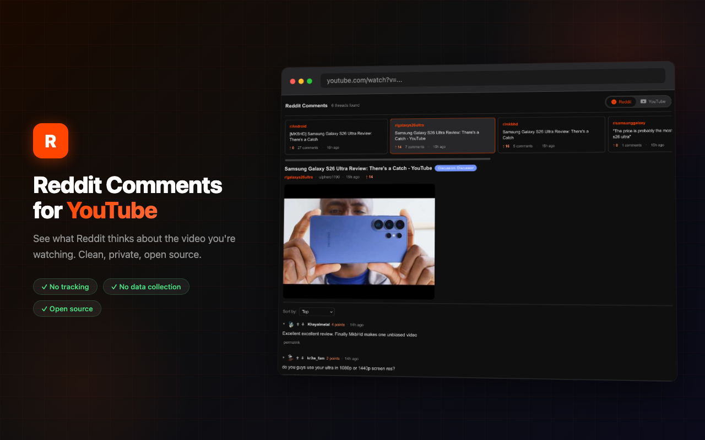
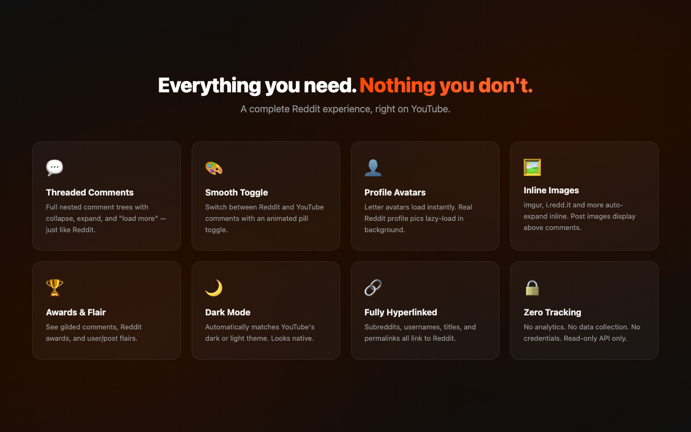
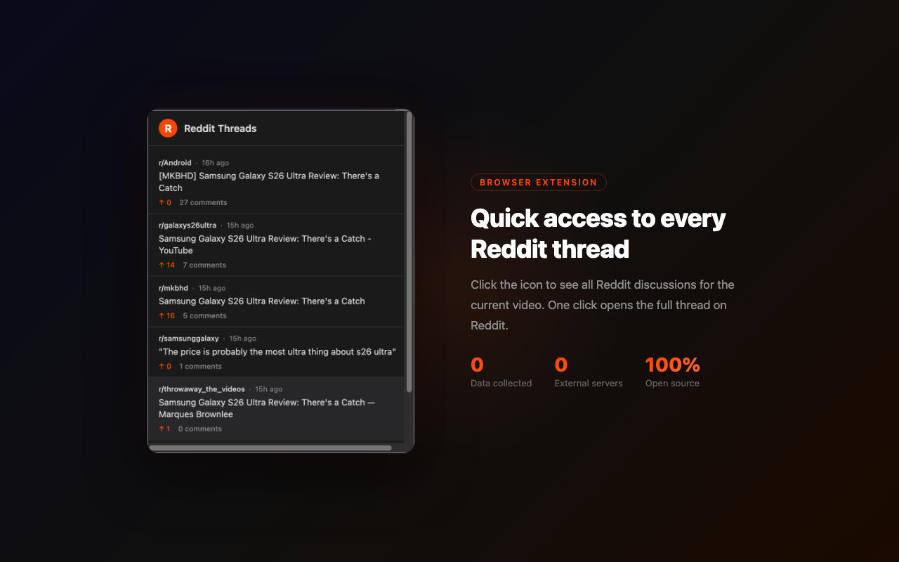

# Reddit Comments for YouTube

[](https://addons.mozilla.org/en-US/firefox/addon/reddit-comments-for-youtube/)
[](LICENSE)

A clean, privacy-respecting browser extension that shows Reddit discussions on YouTube videos. See what Reddit thinks about the video you're watching.







## Install

**[Install for Firefox](https://addons.mozilla.org/en-US/firefox/addon/reddit-comments-for-youtube/)** — from the official Mozilla Add-ons store.

<details>
<summary>Manual / Development install</summary>

### Firefox (temporary)

1. Open `about:debugging#/runtime/this-firefox`
2. Click **"Load Temporary Add-on..."**
3. Select the `manifest.json` file from this directory

### Firefox (development with auto-reload)

```bash
npx web-ext run --firefox=firefox
```

### Chrome

1. Open `chrome://extensions`
2. Enable **"Developer mode"**
3. Click **"Load unpacked"**
4. Select this directory

</details>

## Features

- **Reddit comments on YouTube** — Automatically finds and displays Reddit threads for the video you're watching
- **Flexible comment flow** — Switch between Reddit and YouTube, or combine both into one continuous scroll
- **Multiple thread layouts** — Choose horizontal cards or a compact vertical list
- **Parent comment limits** — Show All, 5, 10, 20, or 50 top-level Reddit comments before YouTube
- **Nested comment trees** — Full threaded comments with collapse/expand, just like Reddit
- **Profile avatars** — Letter avatars load instantly, real Reddit profile pictures lazy-load in the background
- **Inline image previews** — Image links (imgur, i.redd.it, etc.) auto-expand inline
- **Optional post images** — Show or hide the active Reddit post's large thumbnail
- **"Load more" comments** — Expand truncated comment threads
- **Sort comments** — Best, Top, New, Old, Controversial — preference is remembered
- **Awards & flair** — Gilded/awarded comments and user/post flairs are displayed
- **Dark mode** — Automatically matches YouTube's dark/light theme
- **Hyperlinked everything** — Subreddits, usernames, post titles, and permalinks all link to Reddit
- **Watch and live pages** — The in-page panel appears on `/watch?v=` and `/live/` pages; on Shorts and `/embed/` links, threads are listed in the toolbar popup
- **Works signed out** — Without a Reddit login you still get the top threads and comments, with a notice linking to Reddit's sign-in for the full set

## Privacy

**This extension collects zero data.** No analytics, no tracking, and no servers other than Reddit.

It talks only to reddit.com, and only to read: it searches for threads and fetches comments. It never votes, posts, or changes anything.

Requests are sent with your browser's existing Reddit cookies, so when you are signed in, Reddit sees them as coming from your account. The extension never reads, stores, or forwards those cookies or any token.

Signed out, it falls back to Reddit's public pages, which show fewer threads and comments per video. The panel and popup say so, with a link to sign in.

## How It Works

1. **Content script** runs on YouTube pages and detects video navigation (handles YouTube's SPA architecture)
2. **Background script** searches Reddit for posts that link to the video (`url:<video id>`) and keeps only posts whose link points at that exact video. It tries Reddit's JSON API, then old Reddit pages, then Reddit's public pages when you are signed out
3. If Reddit threads are found, YouTube comments are replaced with a Reddit comment panel
4. Comments are fetched and rendered as nested trees with all the Reddit metadata (scores, awards, flairs, avatars)

### Architecture

```
manifest.json      → Extension config (Manifest V2, Firefox)
background.js      → Reddit API calls, caching (5min TTL), rate limiting, avatar fetching
content.js         → YouTube SPA detection, UI injection, comment rendering
content.css        → Styles with CSS variables for dark/light mode
popup.html/js/css  → Extension popup showing thread list
utils.js           → Shared utilities (sanitizer, time formatting, image detection)
icons/             → Extension icons (grey default, orange when threads found)
```

No build step. No bundler. No framework. Just plain JavaScript and CSS.

## Why This Exists

The popular "Comet - Reddit Comments on YouTube" extension was found to contain malicious code. Specifically, its background script:

1. Fetches your Reddit session data via `old.reddit.com/api/me.json` with your cookies
2. Sends your entire Reddit profile (username, modhash/session token, email, karma, etc.) to an external server at `45.76.61.40:5000`
3. Runs on extension install and repeats daily via a Chrome alarm

The modhash token allows someone to vote, comment, and take actions **as you** on Reddit. The data is sent over plain HTTP, making it interceptable.

**If you have Comet installed, uninstall it immediately**, log out of all Reddit sessions, and change your password.

This extension was built from scratch as a clean replacement with the same functionality and zero data collection.

## License

MIT
